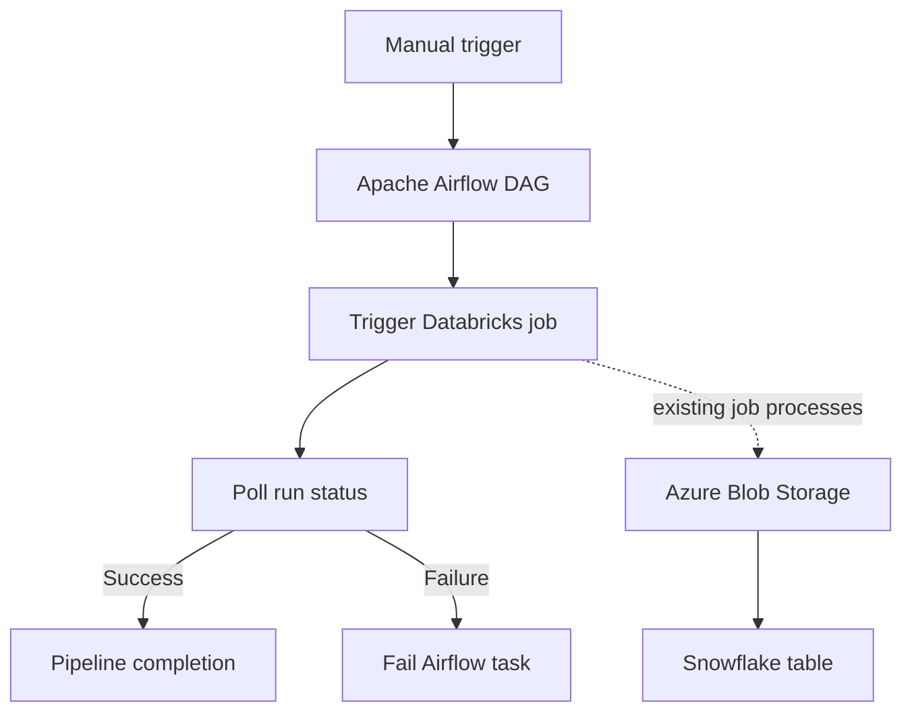

# Airflow-Orchestrated Sales ETL: Databricks, Azure Blob Storage & Snowflake

A portfolio project demonstrating manual Airflow orchestration of an existing Databricks ETL job, with Azure Blob Storage as the file layer and Snowflake as the analytics destination.

> **Security:** Never commit access tokens, connection strings, passwords, private keys, `.env` files, or downloaded cloud credentials. The Airflow VM keeps Databricks credentials in `~/airflow/.databricks_env`, outside this repository.

## Architecture

1. A user manually triggers the Airflow DAG.
2. Airflow starts the existing Databricks job through the Jobs REST API.
3. Airflow polls the Databricks run until it succeeds or fails.
4. Airflow runs a lightweight completion step.
5. The Databricks job reads sales input from Azure Blob Storage, transforms it, writes `sales/output/sales_result.csv`, and loads the result into Snowflake.



## Current environment configuration

These are environment-specific resources used in the development setup. Do not include secrets in Git.

- Databricks job: `azure-blob-to-snowflake-etl`
- Azure Blob input: `sales/input/sales.csv`
- Azure Blob output: `sales/output/sales_result.csv`
- Snowflake target: `PROJECT_DB.SALES.K_SALES_RESULT`
- Airflow DAG ID: `full_etl_pipeline`
- DAG schedule: manual trigger only (`schedule=None`)

The previous Snowflake validation reported 6 rows, total amount `282500`, total discount `18600`, and net amount `263900`. Re-run validation before presenting these as the latest results.

## Repository structure

```text
.
├── dags/
│   └── full_etl_pipeline.py
├── scripts/
│   ├── task3_validate.sh
│   └── task4_finish.sh
├── docs/
│   └── validation.sql
├── .gitignore
├── requirements.txt
└── README.md
```

## Prerequisites

- Apache Airflow 2.11.x with a scheduler and task executor configured
- Python 3.12+
- A Databricks workspace and an existing Jobs API job
- Azure Blob Storage and Snowflake configured inside the Databricks job
- Network access from the Airflow VM to the Databricks workspace

## Configure Databricks credentials on the Airflow VM

Create a protected file outside the repository:

```bash
cat > ~/airflow/.databricks_env <<'EOF'
DATABRICKS_HOST="https://<your-workspace-host>"
DATABRICKS_TOKEN="<your-personal-access-token>"
EOF
chmod 600 ~/airflow/.databricks_env
```

Replace placeholders locally. Never paste the real token into GitHub, screenshots, issue reports, or chat.

Set `JOB_ID` in `dags/full_etl_pipeline.py` to your existing job ID. The included example uses the ID from the development environment; replace it if your workspace differs.

## Install dependencies

Activate the same Python environment used by Airflow, then:

```bash
pip install -r requirements.txt
```

The DAG uses Airflow's installed packages plus `requests`. Do not install a different Airflow version into a running production environment without checking compatibility.

## Deploy on the Airflow VM

Copy the DAG to the configured DAG directory and scripts to the scripts directory:

```bash
cp dags/full_etl_pipeline.py ~/airflow/dags/
mkdir -p ~/airflow/scripts
cp scripts/task3_validate.sh scripts/task4_finish.sh ~/airflow/scripts/
chmod +x ~/airflow/scripts/*.sh
```

Check parsing:

```bash
airflow dags list-import-errors
airflow dags list | grep full_etl_pipeline
```

The DAG is intentionally manual-trigger only. Trigger it from the Airflow UI or run:

```bash
airflow dags trigger full_etl_pipeline
```

Do not repeatedly trigger while a run is in progress. Inspect the existing run first.

## Validation

The included shell validation checks that the output CSV exists only if the path is mounted locally on the Airflow VM. If the output exists only in Azure Blob, replace the example with a real Azure SDK check or validate it from Databricks/Snowflake. The completion task does not prove that the data is correct.

Snowflake SQL is in `docs/validation.sql`. Run it in your Snowflake worksheet after the Databricks job succeeds.

## Troubleshooting

- `TemplateNotFound` from BashOperator: Airflow may interpret a command ending in `.sh` as a Jinja template path. The DAG uses a trailing space in `bash_command` to prevent this.
- `401`/`403` from Databricks: verify the host, token permissions, and job access without printing the token.
- Task stuck in `queued`: check scheduler/worker health and executor configuration.
- Databricks run fails: inspect the run output in the Databricks Jobs UI.
- Import errors: run `airflow dags list-import-errors` and inspect the traceback.

## Portfolio improvements

- Add a true Azure Blob existence/size check.
- Add Snowflake row-count and aggregate assertions as a downstream validation task.
- Add retries, task timeouts, structured logs, and notifications.
- Add screenshots of the Airflow graph and successful Databricks run with secrets and IDs redacted.
- Add a sample CSV containing synthetic data only.
